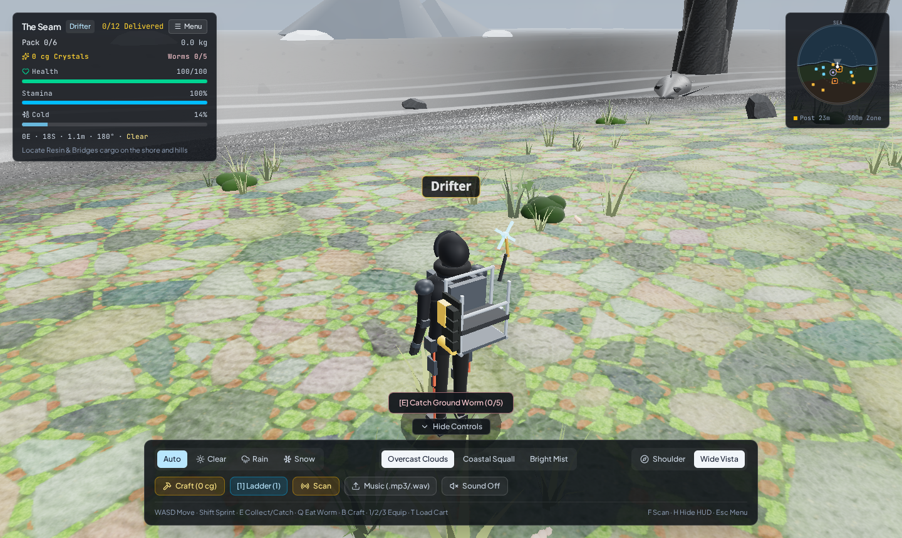
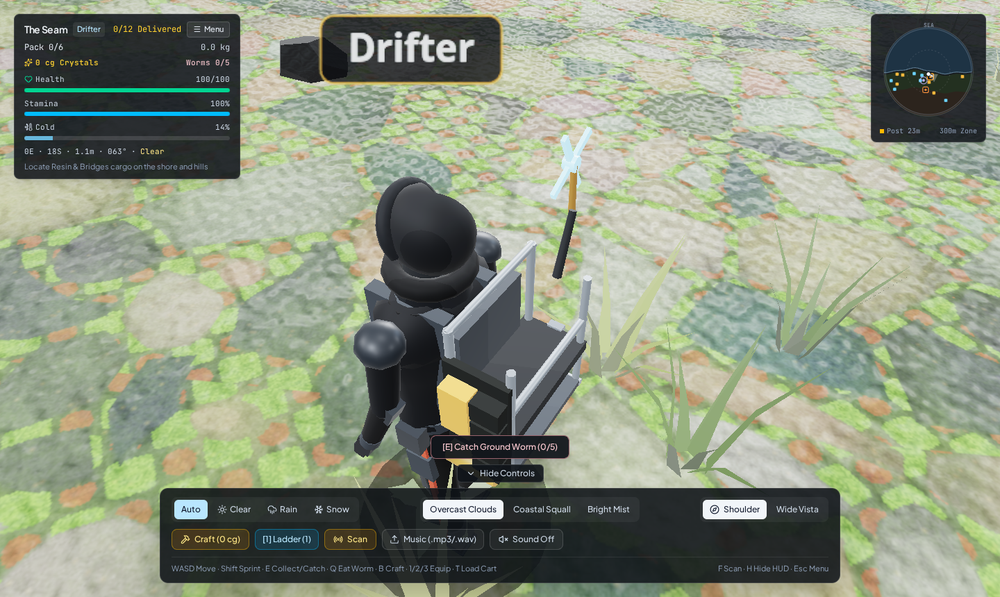
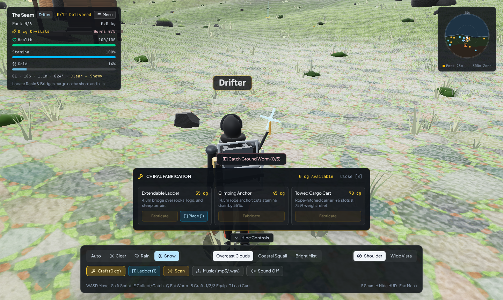
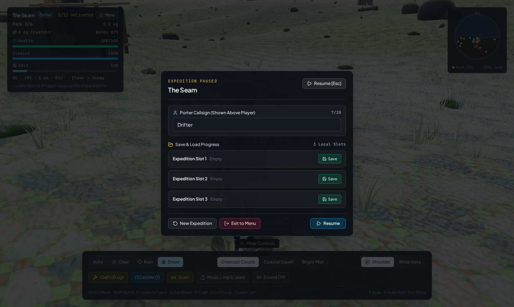

# The Seam — Volcanic Beach

An atmospheric 3D third-person coastal survival and cargo delivery expedition built with **React**, **TypeScript**, **Three.js**, and procedural **WebGL / Web Audio** synthesis.

Traverse a desolate black volcanic shoreline, moss-covered basalt highlands, and stepped desert-rock mountain cliffs as an articulated porter—scavenging lost cargo, harvesting hidden chiral crystals, fabricating traversal gear, and weathering shifting coastal squalls and snowstorms.

---

## Screenshots

| Coastal Shoreline & Wide Vista | Green Highlands & Cobble Hollows |
| :---: | :---: |
|  |  |
| *Volcanic sand shoreline, rolling ocean surf, sea stacks, and tactical radar* | *Shoulder view with live callsign badge, Odradek scanner, and mossy cobble turf* |

| Dynamic Snow & Chiral Fabrication | Expedition Menu & Save Slots |
| :---: | :---: |
|  |  |
| *Transitioning snowfall across green hills with equipment crafting open* | *Editable 3D callsign, 3 local save/load slots, and Wooden Outpost refuge* |

---

## Key Features

### Procedural 3D World & Realistic Terrain
- **Multi-Biome Coastal Terrain**: Deterministic analytical heightfield (`920m × 920m` mesh, `300m` playable perimeter) transitioning from wet black volcanic sand and ocean surf into mossy green highlands, fractured basalt cliffs, and inland desert-rock escarpments.
- **Procedural PBR Surface Materials**: Custom 512px canvas albedo and tangent-space normal maps for wet river cobbles with crevice greenery, lush olive-emerald moss turf, fractured dark basalt rock, and warm inland sandstone/desert cliff bands.
- **Rich Ground Cover & Landmarks**: Instanced grass clusters, mossy shrubs, broadleaf ground shoots, weathered driftwood logs, basalt sea stacks, stranded leviathans, a coastal **Wooden Outpost**, and an inland **Mountain Refuge** hut.

### Articulated Porter, Load Physics & Survival
- **Carry Stack & Center-of-Mass**: Collect up to 6 cargo containers (`Resin` & `Bridges` crates with randomized weights) stacked dynamically onto the porter's backpack frame. Weight directly slows movement speed and increases stamina drain.
- **Health, Stamina & Cold Exposure**:
  - **Stamina** drains while sprinting, climbing steep terrain, or hauling heavy cargo, triggering an exhaustion cooldown when depleted.
  - **Cold Feeling** rises during rain, snow, and ocean wading; stepping inside the Wooden Outpost or Mountain Refuge shelter warms the porter back down.
  - **Ground Worms**: Catch and pouch up to 5 ground worms scattered around bushes and grasses (`96` spawns) to restore health, stamina, and warmth on the move.
- **Live 3D Callsign**: Customize your porter callsign in the Expedition Menu and see it update live on the floating 3D nameplate above the character.

### Chiral Crystal Harvesting & Field Fabrication
- **Unmarked Chiral Crystals**: Hidden crystal clusters spawn organically across the terrain without minimap markers—scan (`F`) or explore rocky outcrops to harvest chiral gold (`cg`).
- **Craftable Traversal Equipment (`B`)**:
  - **Extendable Ladder (`35 cg`)**: Deploy a 4.8m bridge over boulders, logs, and steep cliff ledges (`[1]`).
  - **Climbing Anchor (`45 cg`)**: Plant a 14.5m rope anchor that cuts stamina drain by 55% within its assist radius (`[2]`).
  - **Towed Cargo Cart (`70 cg`)**: Rope-hitched trailing carrier adding `+6` cargo slots and `75%` effective weight relief; hitch/unhitch (`[3]`) or shift pack cargo into the cart (`[T]`).

### Dynamic Volumetric Weather & Procedural Audio
- **Weather State Machine**: Smoothly transitions between **Clear**, **Rainy**, and **Snowy** conditions (in `Auto` cycle or manual override), complete with volumetric rain streaks, swirling snow particles, dynamic fog/lighting presets (`Overcast Clouds`, `Coastal Squall`, `Bright Mist`), and terrain snow accumulation.
- **Surface-Aware Web Audio**: Procedural ocean waves and wind bed paired with surface-specific footsteps (crunching volcanic sand, wet surf splashes, and metallic cargo clinks under load).
- **One-Shot Overlook Music & Custom Tracks**: Reaching the Coastal Overlook waypoint triggers a one-shot 1:45 ambient composition with a fading title banner, or upload your own `.mp3` / `.wav` track directly from the bottom dock.

### Save & Load System
- **3 Local Save Slots**: Persist player coordinates, heading, health, stamina, cold level, callsign, cargo states, crystals, deployed ladders/anchors, cart contents, worm pouch, weather mode, and atmosphere preset in `localStorage`.

---

## Controls

| Key / Input | Action |
| :--- | :--- |
| `W` `A` `S` `D` | Move (or use on-screen touch pad on mobile) |
| `Shift` | Sprint |
| `Space` | Jump |
| `Mouse Drag` / `Scroll` | Orbit camera & zoom |
| `E` | Collect cargo, harvest crystals, catch/eat worm, or deliver at Wooden Outpost |
| `Q` | Eat ground worm from pouch (+Health, +Stamina, +Warmth) |
| `B` | Toggle Chiral Fabrication crafting drawer |
| `1` / `2` / `3` | Place Ladder / Plant Climbing Anchor / Hitch or Unhitch Towed Cart |
| `T` | Shift backpack cargo onto hitched Towed Cart |
| `F` | Pulse Odradek terrain & cargo scanner |
| `H` | Toggle HUD & bottom control dock visibility |
| `Esc` | Open / close Expedition Pause, Save/Load & Callsign Menu |

---

## Tech Stack

- **Frontend & UI**: React 19, TypeScript, Tailwind CSS v4, Lucide React
- **3D Engine**: Three.js (`0.187.0`) with custom GLSL `onBeforeCompile` terrain/weather shaders
- **Audio**: Native Web Audio API procedural synthesis + local MP3/WAV playback
- **Build Tooling**: Vite 8

---

## Project Structure

```text
├── docs/
│   └── screenshots/          # Captured in-game screenshots
├── public/                   # Static assets
├── src/
│   ├── components/
│   │   └── ControlOverlay.tsx # HUD, tactical radar, crafting drawer, pause/save menu
│   ├── scene/
│   │   ├── BeachExperience.ts # Main Three.js loop, physics, camera, and input controller
│   │   ├── audio.ts           # Procedural surf, footsteps, scan pulses, & custom MP3/WAV player
│   │   ├── cargo.ts           # Cargo crates, delivery post, & backpack/cart load logic
│   │   ├── character.ts       # Articulated porter mesh, Odradek scanner, & floating nameplate
│   │   ├── crystals.ts        # Hidden chiral crystal clusters & harvesting
│   │   ├── environment.ts     # Terrain mesh, ocean shader, landmarks, foliage & rock obstacles
│   │   ├── equipment.ts       # Extendable ladders, climbing anchors, & rope-towed cargo cart
│   │   ├── materials.ts       # Procedural 512px PBR textures & atmosphere presets
│   │   ├── saveSystem.ts      # LocalStorage 3-slot save/load & callsign persistence
│   │   ├── terrain.ts         # Analytical heightfield, shoreline curve, & boundary math
│   │   ├── weather.ts         # Clear / Rain / Snow transitions & particle systems
│   │   └── worms.ts           # Ground worm spawns & pouch recovery mechanics
│   ├── App.tsx                # React shell & menu state orchestration
│   ├── index.css              # Tailwind v4 global styling
│   └── main.tsx               # Application entry point
├── index.html
├── metadata.json
└── package.json
```

---

## Getting Started

### Prerequisites
- **Node.js** 18+ and **npm**

### Installation & Local Development

```bash
# Install dependencies
npm install

# Start the development server on port 3000
npm run dev
```

Open `http://localhost:3000` in a WebGL-capable browser.

### Typecheck & Production Build

```bash
# Run TypeScript check
npm run lint

# Build production bundle to dist/
npm run build
```
